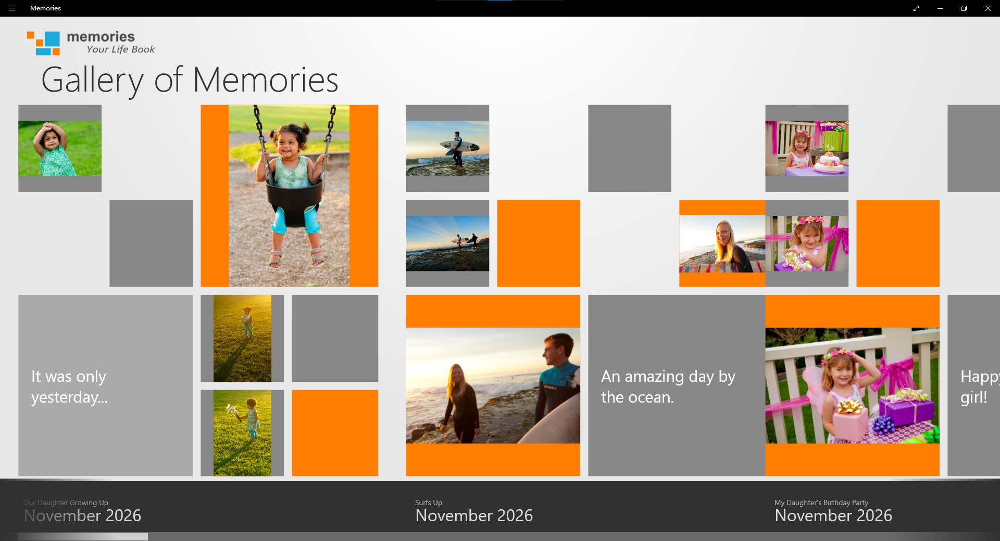
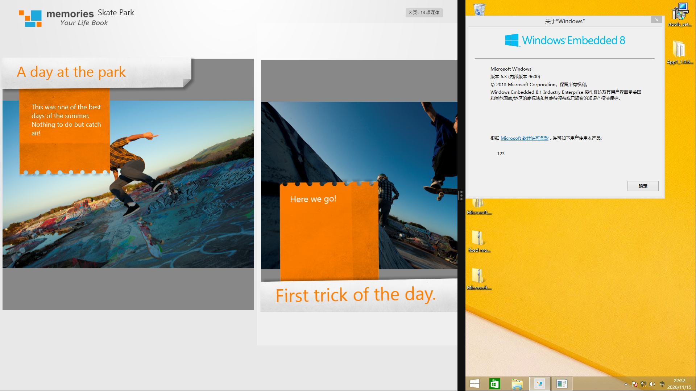

# Memories · MemoriesDemo

> The bundled photo-album sample app from **Windows 8 Build 8102** (Developer Preview, 2011) — decompiled, rewritten, and made runnable again.


<p align="center"></p>
<p align="center"></p>

<p align="right"><sub><b>English</b> · <a href="README.zh-CN.md">简体中文</a></sub></p>

---

## ⚠️ Before You Start — Please Read the Following Carefully !!!!

> **The fixes in this version were carried out with the help of AI. The code may contain unknown issues — you must review it carefully before building it for real !!!!**
>
> **Model used: DeepSeek V4.1 Flash**

Concretely, here is what you should know:

- A substantial part of the code was **decompiled and then rewritten**, so it retains the original structure, naming, and call order. This is not a "clean" codebase.
- Much of the work was driven by **runtime symptoms and crash-dump analysis**. Several changes exist to "stop it from crashing" rather than to "make it correct". Edge cases are not guaranteed to be covered.
- **There is no automated test suite.** Every feature was verified by hand, one click at a time.
- This repository **ships no original art assets** (`Images/` is empty). You will need to supply your own — see [Art assets](#art-assets).

If you are looking for a store-ready template, this is not it. If you want to study what an early WinRT app actually looked like from the inside, welcome.

---

## About this project

**Memories** was a sample photo-album app bundled with **Windows 8 Build 8102 (Developer Preview)**. It laid photos and videos out as a magazine you could flip through — with page-turn animations, layout templates, an edit mode, and full-screen viewing.

Its Store package is long gone, the matching Win8 DP SDK can no longer be obtained, and the original `memoriesdemo.exe` will not run on a modern system.

This repository's code was **decompiled from the original `memoriesdemo.exe` and rewritten**:

| What was done | Details |
|---|---|
| Missing / deprecated APIs | Types that only exist in Win8.1 were replaced one by one with Win8.0-compatible equivalents |
| Crash fixes | Mostly memory exhaustion during image decoding, and null references during page transitions |
| Namespace cleanup | Everything consolidated under `MemoriesDemo.*`; project renamed to `MemoriesDemo.csproj` |
| Preserved behavior | In-place playback, in-place zoom, page-turn animation — all kept as the original behaved, with no "experience redesign" |

After the rewrite, **most features work normally**, but undiscovered issues may remain — see [Known issues](#known-issues--limitations).

---

## Compatibility

Tested on real machines, launching and usable:

| OS | Build | Status |
|---|---|---|
| Windows 8.1 | 6.3.9600 | ✅ Opens and works |
| Windows 10 | 10.0.19045 (22H2) | ✅ Opens and works |
| Windows 11 | 10.0.26200 | ✅ Opens and works |

> The project still targets **Windows 8.0** (`OSMinVersion` 6.2) and the manifest is written against the Win8.0 schema. Running on newer builds is therefore **compatibility-mode execution**, not native support — a few system-level behaviors (tile rendering, for instance) will follow the newer OS rather than Win8.

**Not tested:** Windows 8.0 on real hardware or in a VM, ARM devices, Xbox. Win8.0 is the closest to the original target and should behave best in theory, but there is no measured data.

---

## Getting started

### Requirements

| Item | Requirement |
|---|---|
| IDE | Visual Studio 2012 (Update 4 or later recommended) |
| SDK | **Windows 8.0 SDK** — not the 8.1 SDK, whose assemblies conflict with an 8.0 target |
| OS | Windows 8 / 8.1 / 10 / 11, with the ability to install VS2012 and obtain a developer license |
| Runtime | .NET Framework 4.5 |

### Build steps

1. **Clone the repository**

   ```bash
   git clone https://github.com/xiaom9446/MemoriesDemo_Restored.git
   ```

2. **Add the art assets** — open `Images/` and drop in the files listed in [Art assets](#art-assets). Missing images still compile, but tiles and the splash screen will be blank.

2. **Create Solution** — Language Selection: Visual C # ->Windows Store App ->Blank Application. Remove the generated MainPage.xaml, MainPage.cs from the application and add them to the project source code.

4. **Pick a platform** — `Any CPU` in the toolbar (the default). To escape the 32-bit memory ceiling, choose `x64` **and set `Prefer32Bit` to `false`** — otherwise it is still a 32-bit process (see [Known issues](#known-issues--limitations)).

5. **Clean, then rebuild**

   ```
   Build → Clean Solution → Rebuild Solution
   ```

   > After renaming the project or changing `AssemblyName`, **always clean first**. Otherwise `bin/` keeps a stale `App1.exe` and deployment fails with "the executable referenced in the manifest could not be found".

6. **Deploy**

   - The first deployment needs a developer license. VS will prompt you; follow the wizard.
   - If an older `/Memories/` package is installed, remove it first:

     ```powershell
     Get-AppxPackage *Memories* | Remove-AppxPackage
     ```

   - Debug → Start Without Debugging.

7. **Verify the output**

   `bin/Debug/` (or `bin/x64/Debug/`) should contain **`MemoriesDemo.exe`**. That is exactly what the manifest's `Executable` attribute points to; the two must match.

### Art assets

The following files are required in `Images/`. Names must match exactly — the manifest and code reference them by name.

| File | Purpose | Suggested size |
|---|---|---|
| `150Tile.png` | Square tile | 150 × 150 |
| `310Tile.png` | Wide tile | 310 × 150 |
| `30Tile.png` | Small tile | 30 × 30 |
| `Logo.png` | App logo | 150 × 150 |
| `SmallLogo.png` | Small logo | 30 × 30 |
| `StoreLogo.png` | Store logo | 50 × 50 |
| `SplashScreen.png` | Splash screen | 620 × 300 |
| `MemoriesSplash01.png` | Splash variant | 620 × 300 |
| `MemoriesSplash03.png` | Splash variant | 620 × 300 |
| `Small_Tile.png` | Alternate small tile | 30 × 30 |
| `Tile_Option_2.png` | Alternate wide tile | 310 × 150 |

> Wrong dimensions produce no build error, but the system falls back to the default grey icon — which looks exactly like "the tile isn't working".

**Use images you actually own the rights to.** The original assets belong to Microsoft and are not included here.

---

## Project layout

```
MemoriesDemo/
├─ App.cs                     Entry point, app lifetime, global exception handler
├─ Program.cs                 Main for the AppContainerExe
├─ MainPage.xaml/.cs          Shell: top bar, back button, navigation, page transitions
├─ AppxManifest.xml           Package manifest (identity, tiles, capabilities)
├─ app.manifest               Win32-level manifest
├─ MemoriesDemo.csproj
├─ Properties/AssemblyInfo.cs
├─ Views/                     Pages and card views (40 files)
│  ├─ AlbumsView              Home: album list
│  ├─ AlbumDetailsView        Detail: horizontal paging + edit mode
│  ├─ MediaPageItemView       Photo / video card
│  ├─ TextPageItemView        Text card
│  ├─ AlbumSlideShowView      Full-screen slideshow
│  └─ ...
├─ ViewTemplates/             Layout templates (Basic 1–7, Scrap 1–8 — 30 files)
├─ ViewModels/                Data layer (12 files)
├─ Helpers/                   View helpers, file and media plumbing (21 files)
└─ Images/                    Art assets (bring your own)
```

---

## Technical notes

### What kind of app this is

- **WinRT / Windows 8 Store app** (`OutputType = AppContainerExe`), C# + XAML. Not WPF, not WinForms.
- Runs inside the AppContainer sandbox: file access goes through `Windows.Storage`, UI through `Windows.UI.Xaml`.
- Targets Win8.0, so **a large set of 8.1+ APIs is unavailable**: `MediaPlayer`, `MediaSource`, `MediaPlaybackItem`, `MediaComposition`, `MediaElement.AreTransportControlsEnabled`, and others.

### Main changes made during the rewrite

| Location | Change | Reason |
|---|---|---|
| `Helpers/AlbumItemTemplateViewHelper.cs` | `DecodePixelWidth` added to every image decode | Decoding at full resolution means a single 23-megapixel photo requests a ~89 MB pixel buffer; a 32-bit process hits `TerminateProcessOnMemoryExhaustion` immediately |
| `Helpers/MediaPageItemViewHelper.cs` | Same, capped by page width | The detail view's large images had the identical problem |
| `Helpers/AlbumItemTemplateViewHelper.cs` | Page-liveness check inside the async image callback | If you tapped into an album before the images finished loading, the callback wrote into a visual tree that no longer existed |
| `Helpers/AlbumPageViewHelper.cs` | Added `using Windows.UI;` | `Colors` failed to resolve |
| `App.cs` | Removed `Application.Exiting` | Win8.0 has no such event; `Suspending` / `Resuming` are used instead |
| Everywhere | Namespaces unified under `MemoriesDemo.*` | The original mixed several prefixes |

### The animation system

The animation here is more involved than it looks. Keep this in mind before touching anything:

- **98 `Storyboard`s** across 20 XAML files, plus 66 animation objects constructed in code.
- The 7 tiles on an album card **stagger in**, chained through `Completed` callbacks.
- The "card → full screen" zoom has no `ConnectedAnimation` available, so it is a **hand-written frame-by-frame easing**: `_fps = 15`, and every tick re-sets `Canvas.Left/Top` and swaps the `RectangleGeometry` on `Canvas_LargeView.Clip`.
- `TransitionInfo._isInTransitionAnimation` is a global mutex flag. Touching the visual tree while it is set (especially `Children.Clear()`) will silently kill a Storyboard or leave it half-applied.

**Never mutate the visual tree inside that animation window.**

---

## Known issues & limitations

### 1. Large videos plus a 32-bit process can crash the app

`MediaElement` synchronously spins up a Media Foundation decoding pipeline the moment it receives a `Source`. A 171 MB video occupies roughly 400 MB of memory. The detail view's `ItemsPanel` is a **non-virtualized `StackPanel`**, so every page exists at once — meaning every video in the album builds its own pipeline.

Stack image decoding on top of that and an x86 process (2–4 GB of user-mode address space) runs out. When it does, XAML calls `TerminateProcess` itself, and **no managed `try/catch` will catch it**.

Workarounds:

- Limit how many videos, and how large, go into a single album;
- Or switch to a genuine x64 build: `PlatformTarget = x64` **and** `Prefer32Bit = false`.

> Note: the x64 configuration in this project still sets `Prefer32Bit = true`, which keeps it a 32-bit process — the switch accomplishes nothing until you change it.

### 2. Returning to the home screen takes 1–2 seconds

Home thumbnails go through `StorageFile.GetFileFromPathAsync` + `OpenAsync` + a synchronous `SetSource`. That is two cross-process round trips per image, and the result **does not participate in XAML's image cache**, so the cost is paid again on every return.

This can be optimized by handing the files to `BitmapImage.UriSource` via `ms-appdata://`, letting XAML decode in the background and cache the result — but those decoded bitmaps then stay resident, which makes a 32-bit process hit the ceiling sooner. It is a genuine trade-off; this version chose "slow but stable".

### 3. Non-virtualized pages

Both `AlbumsView` and `AlbumDetailsView` use a horizontal `StackPanel` as their `ItemsPanel`, so every card is created at once. With many albums or many pages, initialization is noticeably slow.

### 4. Live tiles are not implemented

The original never had them. Searching the decompiled output for `TileUpdateManager`, `TileNotification`, or `SecondaryTile` yields zero hits; the tile is a static `DefaultTile`.

So the "turn live tile on" toggle in the Start screen's right-click menu will do nothing — there is no notification queue to toggle. This is not a bug.

### 5. Tile rendering on Win10 / Win11

Wide tiles from Win8 apps are frequently cropped to square in the Win10/11 Start menu, and multi-image rotation may collapse to a single image. Even if you implement live tiles yourself, the result will not look like Win8.

### 6. Unverified paths

Page reordering in edit mode, some layout templates, and search suggestions were only smoke-tested. Edge cases are probably not correct.

---

## FAQ

**Q: Why is the executable called `memoriesdemo.exe` while the project is `MemoriesDemo`?**
A: The manifest already declared `memoriesdemo.exe` with `EntryPoint="MemoriesDemo.App"`. Aligning the project to it is simpler than editing the manifest. `AssemblyName` determines the output file name.

**Q: Deployment fails with "the executable referenced in the manifest could not be found".**
A: A stale `App1.exe` is sitting in `bin/`, or nothing was rebuilt. Delete `bin/` and `obj/`, then rebuild.

**Q: Deployment fails with "another version of this package is already installed".**
A: The package identity `Microsoft.Memories` already exists. Run `Get-AppxPackage *Memories* | Remove-AppxPackage`, or bump `Identity@Version` in `AppxManifest.xml`.

**Q: Can I publish this to the Store?**
A: No. The package identity uses Microsoft's name, and the art assets are not yours. This repository is for study and research only.

**Q: I changed the code but the behavior is identical.**
A: XAML's generated intermediates are cached in `obj/`. After renaming or editing the manifest you must clean. Also note this app is full of animation state machines — some changes get swallowed by the guard logic during transitions.

---


## Disclaimer

- The original design, art assets, and overall architecture are copyright **Microsoft Corporation**.
- This code was **decompiled and rewritten** for study, research, and nostalgia. **No license of any kind is granted.** Do not use it commercially or redistribute it.
- The author accepts no responsibility for any consequence of using this code, including but not limited to data loss, system instability, or wasted time.
- To repeat: **the fixes in this version were carried out with the help of AI, the code may contain unknown issues, and you must review it carefully before building it for real.**

---

## Credits

- **Microsoft** — for Memories in 2011, and for a Windows 8 that still believed in things
- **dnSpy** — decompilation, which made the original logic traceable at all
- **WinDbg / WER LocalDumps** — without that dump, this project would have wandered down the wrong road for another ten rounds


<p align="center">
  <sub>Built with VS2012, a 2011 SDK, and a lot of patience.</sub>
</p>
