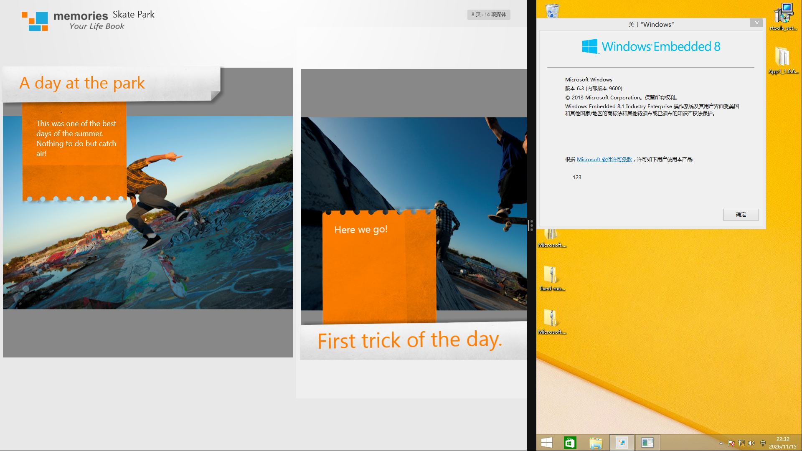
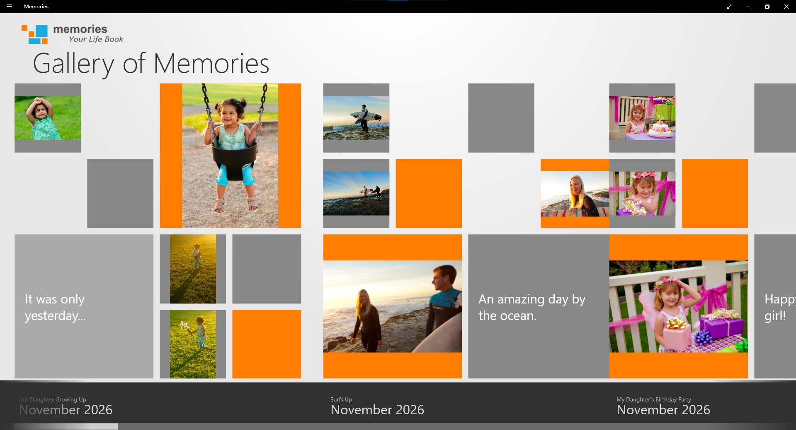

# Memories · MemoriesDemo

> Windows 8 Build 8102（Developer Preview，2011 年）内置相册示例应用 —— 反编译重写版，让它在今天还能跑起来。

<p align="right"><sub><a href="README.md">English</a> · <b>简体中文</b></sub></p>
<p align="center"></p>


<p align="center"></p>


---

## ⚠️ Before You Start — Please Read the Following Carefully !!!!

> **此版本的修复工作借助 AI 完成，代码中可能包含未知的问题，请切记在正式编译前务必仔细检查！！！！**
>
> **使用模型：DeepSeek V4.1 Flash**

具体来说，你需要知道这几件事：

- 相当一部分代码是**从反编译结果重写**的，会保留原版的结构、命名和调用顺序，不代表它是"干净"的工程。
- 修复过程高度依赖**运行时现象 + dump 分析**，部分改动是"让它不崩"，而不是"让它正确"。逻辑层面的边界情况未必覆盖。
- **没有任何自动化测试**。所有功能都是人工点出来的。
- 本仓库**不包含任何原始美术资源**（`Images/` 为空），需要你自行准备，见[资源准备](#资源准备)。

如果你是来找一个可以直接上架的模板，这里不是。如果你是来研究 WinRT 早期应用长什么样，欢迎。

---

## 关于这个项目

**Memories** 是微软在 **Windows 8 Build 8102（Developer Preview）** 里内置的一款示例相册应用：把照片和视频排成一本可以左右翻的"杂志"，带翻页动画、版式模板、编辑模式和全屏查看。

它的商店包早已下架，配套的 Win8 DP SDK 也无法再获取，原版 `memoriesdemo.exe` 在今天的系统上已经无法直接运行。

本仓库的代码基于原版 `memoriesdemo.exe` **反编译后重写**：

| 做了什么 | 说明 |
|---|---|
| 补齐 / 替换已废弃 API | Win8.1 才有的类型在 8.0 上不存在，逐个替换为可用写法 |
| 修复崩溃 | 主要是图片解码引发的内存耗尽、页面切换时的空引用 |
| 统一命名空间 | 全部收敛到 `MemoriesDemo.*`，工程改名为 `MemoriesDemo.csproj` |
| 保持原有交互 | 内嵌播放、原位放大、翻页动画全部按原版行为还原，未做"体验改造" |

重写之后，**大部分功能可以正常使用**，但仍可能存在未被发现和未解决的问题（见[已知问题](#已知问题与限制)）。

---

## 兼容性

已实测能够正常启动并使用的系统：

| 系统 | 版本号 | 状态 |
|---|---|---|
| Windows 8.1 | 6.3.9600 | ✅ 正常打开、功能可用 |
| Windows 10 | 10.0.19045 (22H2) | ✅ 正常打开、功能可用 |
| Windows 11 | 10.0.26200 | ✅ 正常打开、功能可用 |

> 工程的目标平台仍然是 **Windows 8.0（`OSMinVersion` 6.2）**，清单按 Win8.0 的 schema 编写，因此在更高版本系统上属于"兼容运行"，不是原生适配 —— 少数系统级行为（例如磁贴渲染）会与新系统一致而与 Win8 不同。

**未测试**：Windows 8.0 真机/虚拟机、ARM 设备、Xbox。理论上 Win8.0 最接近原生目标，应该最好，但没有实测数据。

---

## 快速开始

### 环境要求

| 项目 | 要求 |
|---|---|
| IDE | Visual Studio 2012（建议 Update 4 及以上） |
| SDK | **Windows 8.0 SDK**（不是 8.1 SDK；8.1 的部分程序集会与 8.0 目标冲突） |
| 系统 | Windows 8 / 8.1 / 10 / 11（需要能安装 VS2012 并获取开发者许可证） |
| 运行时 | .NET Framework 4.5 |

### 编译步骤

1. **克隆仓库**

   ```bash
   git clone https://github.com/xiaom9446/MemoriesDemo_Restored.git
   ```

2. **补齐美术资源** —— 打开 `Images/`，按[资源准备](#资源准备)里的清单放图片。缺图会导致编译通过但磁贴、启动画面空白。

3. **创建解决方案** —— 语言选择Visual C# -> Windows商店应用 -> 空白应用程序XAML 删除生成的MainPage.xaml,MainPage.cs 并加入项目源代码

4. **确认平台** —— 顶部工具栏选 `Any CPU`（默认）。想避开 32 位内存上限就选 `x64`，但**必须同时把 `Prefer32Bit` 设为 `false`**，否则仍然是 32 位进程（详见[已知问题](#已知问题与限制)）。

5. **清理再生成**

   ```
   生成 → 清理解决方案 → 重新生成
   ```

   > 改过工程名或 `AssemblyName` 之后**务必清理**，否则 `bin/` 里会残留旧的 `App1.exe`，导致部署时报"清单中引用的可执行文件不存在"。

6. **部署**

   - 首次部署需要开发者许可证：VS 会弹窗提示，按引导获取即可。
   - 若机器上装过旧的 `/Memories/` 包，先卸载，否则会冲突：

     ```powershell
     Get-AppxPackage *Memories* | Remove-AppxPackage
     ```

   - 调试 → 开始执行（不调试）。

7. **验证产物**

   `bin/Debug/`（或 `bin/x64/Debug/`）下应出现 **`MemoriesDemo.exe`**。清单里写的 `Executable` 就是它，两者必须一致。

### 资源准备

`Images/` 目录下需要以下文件（名称必须完全一致，清单与代码按名字引用）：

| 文件 | 用途 | 建议尺寸 |
|---|---|---|
| `150Tile.png` | 方形磁贴 | 150 × 150 |
| `310Tile.png` | 宽磁贴 | 310 × 150 |
| `30Tile.png` | 小磁贴 | 30 × 30 |
| `Logo.png` | 应用图标 | 150 × 150 |
| `SmallLogo.png` | 小图标 | 30 × 30 |
| `StoreLogo.png` | 商店图标 | 50 × 50 |
| `SplashScreen.png` | 启动画面 | 620 × 300 |
| `MemoriesSplash01.png` | 启动画面变体 | 620 × 300 |
| `MemoriesSplash03.png` | 启动画面变体 | 620 × 300 |
| `Small_Tile.png` | 备用小磁贴 | 30 × 30 |
| `Tile_Option_2.png` | 备用宽磁贴 | 310 × 150 |

> 尺寸不符不会有编译错误，但系统会回退到默认灰色图标，看起来就像"磁贴没生效"。

**请使用你自己拥有版权的图片。** 原版资源属于微软，本仓库不提供。

---

## 目录结构

```
MemoriesDemo/
├─ App.cs                     应用入口、生命周期、全局异常处理
├─ Program.cs                 AppContainerExe 的 Main
├─ MainPage.xaml/.cs          外壳：顶栏、返回、导航、页面过渡
├─ AppxManifest.xml           包清单（身份、磁贴、能力声明）
├─ app.manifest               Win32 层清单
├─ MemoriesDemo.csproj
├─ Properties/AssemblyInfo.cs
├─ Views/                     页面与卡片视图（40 个文件）
│  ├─ AlbumsView              主页：相册列表
│  ├─ AlbumDetailsView        详情页：横向翻页 + 编辑模式
│  ├─ MediaPageItemView       单张照片 / 视频卡片
│  ├─ TextPageItemView        文字卡片
│  ├─ AlbumSlideShowView      幻灯片全屏播放
│  └─ ...
├─ ViewTemplates/             版式模板（Basic 1–7、Scrap 1–8，共 30 个）
├─ ViewModels/                数据层（12 个文件）
├─ Helpers/                   视图辅助、文件与媒体处理（21 个文件）
└─ Images/                    美术资源（需自行补齐）
```

---

## 技术说明

### 这是一个什么类型的应用

- **WinRT / Win8 Store App**（`OutputType = AppContainerExe`），C# + XAML，不是 WPF，也不是 WinForms。
- 运行在 AppContainer 沙盒里，文件访问走 `Windows.Storage`，UI 走 `Windows.UI.Xaml`。
- 目标 Win8.0，所以**大量 8.1+ 的 API 不可用**：`MediaPlayer`、`MediaSource`、`MediaPlaybackItem`、`MediaComposition`、`MediaElement.AreTransportControlsEnabled` 等都没有。

### 重写时的主要改动

| 位置 | 改动 | 原因 |
|---|---|---|
| `Helpers/AlbumItemTemplateViewHelper.cs` | 图片解码统一加 `DecodePixelWidth` | 原先按原图分辨率同步解码，单张 2300 万像素照片会申请 ~89MB 像素缓冲；32 位进程直接触发 `TerminateProcessOnMemoryExhaustion` |
| `Helpers/MediaPageItemViewHelper.cs` | 同上，按页面宽度计算上限 | 详情页大图同样问题 |
| `Helpers/AlbumItemTemplateViewHelper.cs` | 异步读图回调增加页面存活判断 | 图片没加载完就点进相册时，回调会往已销毁的视觉树里塞元素 |
| `Helpers/AlbumPageViewHelper.cs` | 补齐 `using Windows.UI;` | `Colors` 解析失败 |
| `App.cs` | 移除 `Application.Exiting` | Win8.0 没有该事件，改用 `Suspending` / `Resuming` |
| 全部 | 命名空间统一为 `MemoriesDemo.*` | 原版存在多套前缀混用 |

### 动画系统

这个应用的动画比看上去复杂，改代码时要注意：

- 20 个 XAML 文件里共 **98 个 `Storyboard`**，代码里另有 66 处动态动画对象。
- 相册卡片的 7 个 tile 是**错峰入场**，靠 `Completed` 回调串联。
- "卡片 → 全屏"的放大过渡没有 `ConnectedAnimation` 可用，是**手写的逐帧缓动**：`_fps = 15`，每帧重设 `Canvas.Left/Top` 并替换 `Canvas_LargeView.Clip` 的 `RectangleGeometry`。
- `TransitionInfo._isInTransitionAnimation` 是全局互斥标志。动画进行中操作视觉树（尤其 `Children.Clear()`）会让 Storyboard 静默失效或留下半截状态。

**任何改动都不要在动画窗口期碰视觉树。**

---

## 已知问题与限制

### 1. 大体积视频 + 32 位进程 = 可能闪退

`MediaElement` 一拿到 `Source` 就会同步建立 Media Foundation 解码管线，一个 171MB 的视频大约占用 400MB 内存。而相册详情页的 `ItemsPanel` 是**非虚拟化的 `StackPanel`**，所有页同时存在，因此相册里每个视频都会各建一条管线。

叠加图片解码后，x86 进程（2–4GB 用户态地址空间）很容易触顶，此时 XAML 会主动调用 `TerminateProcess`，**托管层的 `try/catch` 抓不到**。

规避方式：

- 控制单个相册里的视频数量与体积；
- 或把平台切成真正的 x64：`PlatformTarget = x64` **且** `Prefer32Bit = false`。

> 注意：工程里 x64 配置目前仍写着 `Prefer32Bit = true`，这样切过去依然是 32 位进程，等于没切。要改。

### 2. 返回主页需要 1–2 秒

主页缩略图走 `StorageFile.GetFileFromPathAsync` + `OpenAsync` + 同步 `SetSource`，一张图两次跨进程往返，且**不参与 XAML 图片缓存**，所以每次返回都要重付一遍。

可优化为 `ms-appdata://` URI 交给 XAML 后台解码并缓存，但那样会让解码结果常驻内存，在 32 位下反而更容易触顶 —— 这是一个明确的取舍，当前版本选择了"慢但稳"。

### 3. 页面非虚拟化

`AlbumsView` 和 `AlbumDetailsView` 都用横排 `StackPanel` 作为 `ItemsPanel`，所有卡片同时创建。相册或页数很多时，初始化会明显变慢。

### 4. 动态磁贴未实现

原版就没有。反编译结果里 `TileUpdateManager` / `TileNotification` / `SecondaryTile` 零命中，磁贴只有静态的 `DefaultTile`。

所以开始屏幕上右键出现的"启用动态磁贴"开关，点了不会有任何变化 —— 这里没有通知队列可开。这不是 bug。

### 5. Win10 / Win11 上的磁贴渲染

Win8 应用的宽磁贴在 Win10/11 的开始菜单里经常被裁成方形，多图轮播也可能只显示一张。即使自行补上动态磁贴，效果也与 Win8 不同。

### 6. 未回归的功能

编辑模式下的重排、部分版式模板、搜索建议等路径只做过冒烟测试，边界情况未必正确。

---

## 常见问题

**Q：为什么 exe 叫 `memoriesdemo.exe`，工程却叫 `MemoriesDemo`？**
A：清单里本来就写着 `memoriesdemo.exe` + `EntryPoint="MemoriesDemo.App"`，工程名对齐它即可。`AssemblyName` 决定产物文件名。

**Q：部署报"清单中引用的可执行文件不存在"。**
A：`bin/` 里有旧的 `App1.exe` 残留，或者根本没重新生成。删除 `bin/`、`obj/` 后重新生成。

**Q：部署报"已安装另一个版本"。**
A：包身份 `Microsoft.Memories` 已存在。先 `Get-AppxPackage *Memories* | Remove-AppxPackage`，或改 `AppxManifest.xml` 的 `Identity@Version`。

**Q：能发布到商店吗？**
A：不能。包身份用的是微软的名义，素材版权也不在你这儿。本仓库仅供学习研究。

**Q：为什么改了代码但行为没变？**
A：XAML 生成的中间文件缓存在 `obj/`，改名或改清单后必须清理。另外注意本应用有大量动画状态机，某些改动会被动画期间的保护逻辑吞掉。

---


## 免责声明

- 本项目中的原始设计、美术资源与整体架构版权归 **Microsoft Corporation** 所有。
- 代码系**反编译后重写**，用于学习、研究与怀旧用途，**不提供任何形式的授权**，请勿商用或再分发。
- 作者不对使用本代码造成的任何后果负责，包括但不限于数据丢失、系统不稳定、时间被浪费。
- 再次强调：**此版本的修复工作借助 AI 完成，代码中可能包含未知的问题，正式编译前务必仔细检查。**

---

## 致谢

- **Microsoft** —— 2011 年的 Memories，和那个还很天真的 Windows 8
- **dnSpy** —— 反编译，让原版逻辑有迹可循
- **WinDbg / WER LocalDumps** —— 没有那份 dump，这个项目会在错误的路上再走十轮
- **DeepSeek V4.1 Flash** —— 参与全部修复工作

---

<p align="center">
  <sub>Built with VS2012, a 2011 SDK, and a lot of patience.</sub>
</p>
